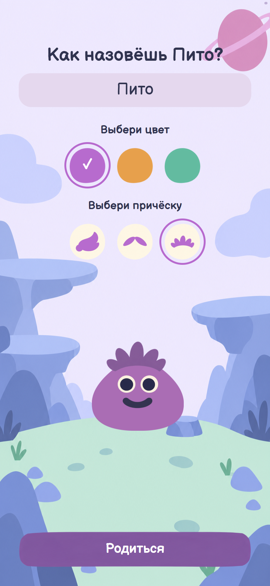

# Как играть в Пито-Пито

[Скачать APK](https://disk.yandex.ru/d/emDP3YPIXSeJRQ) · [На главную](../README.md)

## Установка APK

Нужен Android 8.0 или новее с актуальным Android System WebView. Скачайте и откройте APK. Если Android запросит разрешение, разрешите установку для приложения, которым открыли файл.

**Предупреждение Play Защиты.** Если сообщение говорит, что разработчик ещё не проверен, а файл скачан по ссылке выше и вы доверяете источнику, выберите «Всё равно установить», если этот пункт доступен. Пройдите проверку безопасности, если она предлагается. Отключать защиту целиком не нужно. При сообщении о конкретной угрозе остановите установку и сообщите команде.

Обновление с той же подписью сохраняет профиль. Удаление приложения или его данных удаляет прогресс.

## Первые шаги

1. Выберите имя, цвет и причёску Пито.
2. Познакомьтесь с Пито, покормите и помойте его. Первое яблоко и первый дождик бесплатны; кошелёк пока скрыт.
3. Погладьте Пито, затем выберите первую вещь в подарок. Нажмите на неё на лужайке, чтобы поиграть. Уход пока бесплатный, кошелёк скрыт.
4. Выберите мечту: она сразу появится на главном экране. Когда будете готовы, откройте задание о первом плане. После объяснения познакомьтесь со штучками, получите 20 и распределите их на уход, вещи и накопления. Это единственная стартовая выдача денег.
5. Следуйте плану и самостоятельно пополняйте копилку. Шкала рядом с номером дня показывает течение времени. День заканчивается автоматически; затем можно сравнить план с результатом.
6. Накопите и купите первую мечту. Затем познакомьтесь со вкладом и получите доход, выберите и исполните вторую мечту. Долгие задания сохраняются между днями до выполнения.

Карточка под именем Пито подсказывает следующий шаг. Значок блокнота открывает текущее и выполненные задания с короткими пояснениями навыков. Будущие задания в этом списке скрыты; записи не открывают другие экраны.

Следующие шаги появляются карточками и ждут вашего действия, а не открывают окна по таймеру. Между заданиями можно ухаживать за Пито, смотреть его потребности и рост, открывать настройки. До первого плана игровой день не заканчивается. Старые профили продолжают своё обучение без сброса и повторной выдачи подарков.

## Деньги и план

«Штучки» — игровая валюта. На старте вы получаете 20, каждый новый день — ещё 8. Некоторые задания дают дополнительные награды.

Сохранение плана не списывает деньги. Он задаёт лимиты на уход и вещи и сумму, которую вы хотите отложить. Свободные деньги остаются в кошельке. План выполнен, если расходы не превысили лимиты, а накопления достигли намеченной суммы.

Яблоко стоит 2 штучки. Дождик расходует 1 штучку за 3 секунды воды, даже если Пито чистый. Отпускайте облачко, когда полив больше не нужен. Обычные вещи стоят 4–16 штучек, мечты — 24–56.

**Копилка.** Выберите мечту и переводите деньги из кошелька. После накопления нужной суммы подтвердите покупку. Купленные вещи остаются в локации.

**Вклад.** После покупки первой мечты и выбора следующей, не раньше третьего дня, можно вложить свободные деньги из кошелька. Минимальный вклад — 3 штучки, срок — два игровых дня. За вклад 3–7 штучек начисляется 1 штучка, за 8–12 начисляются 2, от 13 начисляются 3. Кнопка вклада появляется вместе с заданием открыть первый вклад, до задания накопить на вторую мечту. Забрать вложенную сумму можно досрочно, но без дохода. Ранее открытые вклады сохраняют свои условия. Это условная игровая модель, не реальная банковская ставка.

## Как растёт Пито

В конце дня начисляются шаги роста:

- **Уход +1:** купили еду или воду.
- **План +3:** соблюли план и совершили покупки или накопления. Одного сохранения плана недостаточно.
- **Накопления +1:** отложили штучки в копилку или на вклад.

За день можно получить до 5 шагов. Усики появляются при 4 шагах и двух завершённых днях, ножки — при 10 шагах и пяти завершённых днях. Уже полученный рост сохраняется, даже если следующий план не выполнен.

## Настройки и раздел для взрослого

Настройки открываются значком вверху экрана. Здесь можно отключить музыку и звуки. Раздел «Для взрослого» показывает весь список навыков, включая будущие, и отмечает выполненные действия. Короткие описания объясняют их пользу в жизни. Здесь можно начать заново после подтверждения. Для входа нужно решить пример; это защита от случайного нажатия, не пароль.

## Быстрый просмотр

Обычный игровой день длится 4 минуты активной игры. Во время обучения до первого плана и при открытых окнах таймер не идёт. Удерживайте правый верхний угол 1,2 секунды: в меню можно включить скорость ×10 или завершить день сразу. Результат всё равно зависит от ваших действий, а не от ускорения.

Лужайка меняется в шести фазах: утро, день, после полудня, закат, сумерки и ночь. Для каждой фазы используется отдельный рисунок; дневная тема сохраняет исходный вид игры. В конце дня Пито ненадолго засыпает и просыпается на рассвете. Затем появляются итоги плана. Укладывать Пито вручную не нужно.

Прогресс сохраняется автоматически на устройстве. Между Android и браузером он не переносится. В мобильной веб-версии при повороте горизонтально появляется просьба повернуть телефон вертикально; игровой таймер на это время останавливается.

## Чему посвящены задания

| Тема и задания | Что пробует игрок | Объяснение |
|---|---|---|
| Планирование: первый план и «Следуй своему плану» | Распределяет деньги и сравнивает план с результатом | Сохранить план и выполнить его не одно и то же |
| Покупки: первая хотелка и «День хотелок» | Выбирает вещь; в отдельном задании покупает хотелки без пополнения копилки за день | На удовольствия тоже можно выделять деньги |
| Накопления: первая и вторая мечта, «День мечты» | Копит до покупки; в отдельном задании откладывает без покупки хотелок за день | Большую цель можно достигать небольшими шагами |
| Вклады: «Получи доход по вкладу», «Вклад побольше» | Забирает первый вклад с доходом, позже вкладывает больше 10 штучек | Нужно учитывать сумму и срок вклада |
| Разумное потребление: «Помой Пито» | Моет питомца и отпускает облако, когда воды достаточно | Дождик расходует штучки, поэтому его не нужно держать постоянно |

Дополнительные задания появляются с паузами, до составления плана, и не вытесняют незавершённую мечту или знакомство со вкладом. Задание про первый вклад завершается после получения дохода, а не после внесения денег.

[Архитектура](ARCHITECTURE.md) · [Данные и ресурсы](PRIVACY-LICENSES.md)
